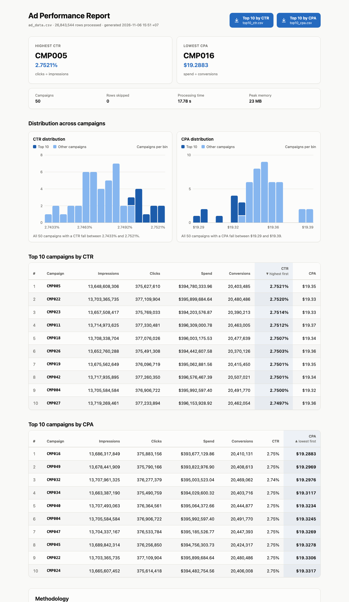
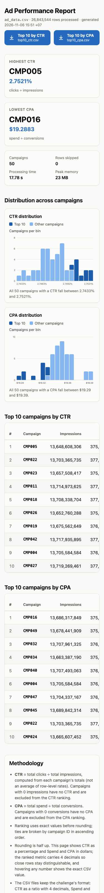
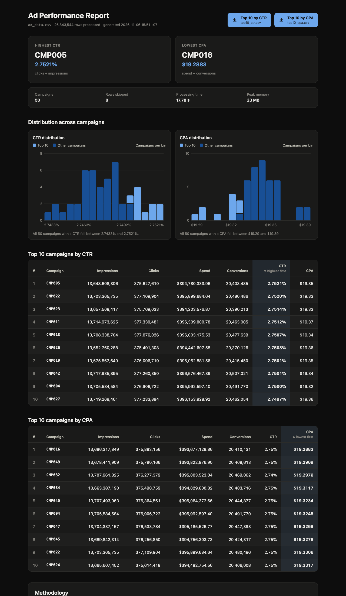

# Ad Performance Aggregator

A command-line tool that reads a large advertising CSV (about 1 GB), aggregates it by `campaign_id`, and writes:

- `results/top10_ctr.csv`: the 10 campaigns with the highest CTR
- `results/top10_cpa.csv`: the 10 campaigns with the lowest CPA, excluding campaigns with zero conversions
- `results/report.html`: a self-contained HTML report of the same results

The tool streams the file in one pass and keeps only one small record per campaign in memory. On the 1 GB dataset it runs in about 17.5 s with a peak memory of about 22 MB.



## Requirements

- Python 3.10 or newer. Nothing else is needed to run it: the tool uses only the standard library.
- To run the tests: [uv](https://docs.astral.sh/uv/), or `pip install pytest`.

## Get the dataset

`ad_data.csv.zip` in the challenge repository is stored with Git LFS, so a normal download returns a 134-byte pointer file instead of the ZIP. Download the real file from GitHub's LFS media endpoint and check its hash:

```bash
mkdir -p data
curl -L -o data/ad_data.csv.zip \
  https://media.githubusercontent.com/media/flinters-vietnam/recruitment/main/fv-sec-001-software-engineer-challenge/ad_data.csv.zip
shasum -a 256 data/ad_data.csv.zip
# 18264bc95be8ce8fb49c219f9ea3f385071fa0f942387982ad89a55f97d90deb
unzip data/ad_data.csv.zip -d data/
```

`data/` is git-ignored.

## Run

```bash
python3 aggregator.py --input data/ad_data.csv --output results/
```

| Option | Effect |
| --- | --- |
| `--input PATH` | Input CSV (required) |
| `--output DIR` | Output directory, created if missing (required) |
| `--skip-invalid` | Skip rows with invalid values instead of stopping. Malformed CSV still stops the run |
| `--quiet` | No progress line and no run summary. Warnings and errors are still printed |
| `--no-html` | Write only the two CSV files |

Progress and the run summary go to stderr, so stdout stays empty. The progress line only appears when stderr is a terminal.

```text
rows read:    26,843,544
rows skipped: 0
campaigns:    50
elapsed:      17.47 s
wrote:        results/top10_ctr.csv
wrote:        results/top10_cpa.csv
wrote:        results/report.html
```

| Exit code | Meaning |
| --- | --- |
| 0 | Success |
| 1 | Data error (bad header, invalid row, malformed CSV) or output cannot be written |
| 2 | Bad arguments or input file not found |
| 130 | Interrupted with Ctrl+C |

## Results on the real dataset

The input has 26,843,544 data rows and 50 campaigns. No row was invalid. Both result files are committed in `results/`.

**Top 10 by CTR** (`results/top10_ctr.csv`)

```text
campaign_id,total_impressions,total_clicks,total_spend,total_conversions,CTR,CPA
CMP005,13648608306,375627610,394780333.96,20403485,0.0275,19.35
CMP022,13703365735,377109904,395899684.64,20480486,0.0275,19.33
CMP023,13657508417,375769033,394203576.87,20390213,0.0275,19.33
CMP011,13714973625,377330481,396309000.78,20463005,0.0275,19.37
CMP018,13708338704,377076026,396003175.53,20477639,0.0275,19.34
CMP026,13652760288,375491308,394442607.58,20370126,0.0275,19.36
CMP019,13675562649,376096719,395062881.56,20415450,0.0275,19.35
CMP042,13717935895,377260350,396576467.39,20507021,0.0275,19.34
CMP004,13705584584,376906722,395992597.40,20491770,0.0275,19.32
CMP027,13719269461,377233894,396153928.92,20462054,0.0275,19.36
```

**Top 10 by lowest CPA** (`results/top10_cpa.csv`)

```text
campaign_id,total_impressions,total_clicks,total_spend,total_conversions,CTR,CPA
CMP016,13686317849,375883156,393677129.86,20410131,0.0275,19.29
CMP049,13678441909,375790166,393822976.90,20408613,0.0275,19.30
CMP032,13707961325,376277379,395003523.04,20469062,0.0274,19.30
CMP034,13663387190,375490759,394029600.32,20403716,0.0275,19.31
CMP040,13707493063,376364561,395064372.66,20444877,0.0275,19.32
CMP004,13705584584,376906722,395992597.40,20491770,0.0275,19.32
CMP047,13704337167,376533784,395185526.77,20447393,0.0275,19.33
CMP045,13689842314,376256850,394756303.73,20424317,0.0275,19.33
CMP022,13703365735,377109904,395899684.64,20480486,0.0275,19.33
CMP024,13665607452,375614418,394482754.56,20406008,0.0275,19.33
```

All ten CTRs round to `0.0275`, so the order cannot be read from the file. The ranking uses exact values. With more decimals the order is clear:

| Rank | Campaign | CTR, 8 decimals |
| --- | --- | --- |
| 1 | CMP005 | 0.02752131 |
| 2 | CMP022 | 0.02751951 |
| 3 | CMP023 | 0.02751373 |
| 10 | CMP027 | 0.02749665 |

The same applies to CPA: CMP049 is 19.296901 and CMP032 is 19.297588, both shown as `19.30`.

## Performance

Measured with `/usr/bin/time -l` on an Apple M4 Pro, macOS, Python 3.15.2. The input file was already in the OS page cache. Full logs are in `benchmarks/`.

| Run | Wall time | Peak memory (max RSS) |
| --- | --- | --- |
| 1 | 17.41 s | 23,019,520 bytes |
| 2 | 17.51 s | 23,134,208 bytes |
| 3 | 17.61 s | 23,035,904 bytes |
| **Median** | **17.51 s** | **about 22 MB** |

That is about 1.5 million rows per second on one core. The time is spent mostly in the CSV parser and in converting text to numbers.

Memory does not grow with the file size. It grows with the number of distinct campaigns: one dict entry with four numbers per campaign. 50 campaigns cost almost nothing; the 22 MB is mostly the Python interpreter itself. A file with millions of distinct campaigns would need a few hundred MB, which is the main known limit of this design.

## Design decisions

**Streaming, one pass.** The file is read row by row with `csv.reader` and never loaded whole. Time is O(rows), memory is O(campaigns). The top 10 lists are picked with `heapq.nsmallest`. I did not use pandas or Polars: they add a large dependency to a job the standard library does in under 20 s, and pandas would need chunking to stay memory-efficient. I did not use multiprocessing either: it would make the code harder to read, and the single-core time is already well within reason.

**Exact money arithmetic.** `spend` is a decimal amount. Summing 26.8 million floats accumulates rounding error, so spend is summed as `Decimal`. Python's default Decimal context keeps only 28 significant digits and rounds silently beyond that. The sum therefore runs in a context with 60 digits and the `Inexact` signal turned into an error: a total either fits exactly or the run stops with a clear message. Integer columns use Python `int`, which never overflows.

**Ratios from totals, compared exactly.** `CTR = total_clicks / total_impressions` and `CPA = total_spend / total_conversions` are computed once per campaign from the totals, never as an average of row-level ratios. They are kept as `Fraction`, so ranking compares exact values and two campaigns tie only if their ratios are truly equal.

**Round only when writing.** One helper rounds a `Fraction` half up using integer arithmetic only and returns a string. It does not use `Decimal.quantize` or `scaleb`, because those also depend on the Decimal context. Spend and CPA have 2 decimals and CTR has 4, matching the example tables in the challenge.

**Deterministic ties.** Equal values are ordered by `campaign_id` ascending, so the output is stable between runs.

**Undefined ratios.**

- A campaign with 0 total conversions has no CPA. Its CPA cell is empty and it is excluded from `top10_cpa.csv`, as the challenge requires.
- A campaign with 0 total impressions has no CTR. Its CTR cell is empty and it is excluded from `top10_ctr.csv`. The challenge does not specify this case; I chose the same rule as for CPA.
- With fewer than 10 eligible campaigns, the file has fewer rows.

**Invalid input.** There are two kinds of problems, handled differently:

| Problem | Default | With `--skip-invalid` |
| --- | --- | --- |
| A row has a wrong number of fields, an empty `campaign_id`, a negative or non-integer count, or a spend that is not a finite non-negative decimal | Stop with exit code 1, file and line number | Skip the row, count it, report the count |
| The CSV structure is broken (bad quoting, invalid UTF-8, a field over the size limit, a read error) or a spend total exceeds 60 digits | Stop with exit code 1, file and line number | Still stop |

By default the tool never drops data silently. Broken CSV structure always stops the run, because after a quoting error the parser can no longer tell where one record ends and the next begins. The reader runs with `strict=True`; the default mode would accept `"CMP001"junk` as the campaign `CMP001junk`.

Other input rules:

- Columns are found by header name, so their order does not matter and extra columns are ignored. A missing required column is an error.
- An empty file is an error. A file with only a header produces result files with only a header.
- A UTF-8 byte order mark is accepted.
- The `date` column is required in the header but not validated, because it is not used.
- Integer fields are parsed with Python's `int()`, which also accepts surrounding spaces, a leading `+`, and `_` digit separators.

**Safe output.** Each output file is written to a temporary file in the output directory and then renamed into place. A failed or interrupted run never leaves a half-written result. The two CSV files are written before the HTML report, so a problem with the report cannot affect them.

## HTML report

`results/report.html` is one static file with inline CSS and inline SVG charts. It has no JavaScript and no external resources, so it opens offline in any browser. It contains:

- the campaign with the highest CTR and the one with the lowest CPA
- run statistics: campaigns, skipped rows, processing time, peak memory
- the distribution of CTR and of CPA across all campaigns, with the top 10 highlighted
- both top-10 tables with ranks, thousands separators, CTR as a percentage and amounts in USD
- a short methodology section

The ranked column shows 4 decimals so close rows can be told apart: all ten CTRs are `0.0275` in the CSV, but `2.7521%` to `2.7497%` in the report. Every number in the tables is computed from the same exact values as the CSV, and hovering it shows the exact CSV cell. Every value from the data is HTML-escaped. The page has a dark mode, a phone layout, and print styles.

The challenge only asks for a CLI. I added the report so the results can be read at a glance without opening the CSV files. It is optional: `--no-html` turns it off.

| Phone | Dark mode |
| --- | --- |
|  |  |

## Tests

```bash
uv run --group dev pytest -q
# or: pip install pytest && python3 -m pytest -q
```

The tests build small CSV files in a temporary directory and run the full CLI on them. They cover:

- the example rows from the challenge, checked against the exact expected file content
- ratios computed from totals rather than averaged
- zero conversions, zero impressions, ties, fewer than 10 campaigns, a header-only file, an empty file, missing columns
- ranking on unrounded values when the rounded values are equal
- rounding half up, exact decimal sums, and a spend total too large for 60 digits
- invalid rows with and without `--skip-invalid`, and malformed CSV that stops even with `--skip-invalid`
- reordered and extra columns, a byte order mark, a missing input file
- no partial output after an error
- the HTML report: escaping of `<script>` in a campaign ID, every CSV value present in the tables, number formatting, histogram binning including edge cases, accessible chart labels, empty states, no external resources, and the `--no-html` and `--quiet` options

## Independent cross-check

`scripts/crosscheck.sql` recomputes both top-10 lists with SQLite, a separate engine with its own CSV parser:

```bash
sqlite3 :memory: < scripts/crosscheck.sql
```

On the real dataset its output matches both result files cell for cell, and it counts the same 26,843,544 rows and 50 campaigns. The log is in `benchmarks/crosscheck.log`. SQLite sums spend as floating point, so this check confirms the totals and the order; the exact ranking itself comes from the `Fraction` comparison in the tool.

## Project layout

```text
aggregator.py          CLI, parsing, aggregation, ranking, CSV output
formatting.py          exact half-up rounding and number formatting, shared by CSV and HTML
report.py              HTML report rendering
tests/                 pytest suite
scripts/crosscheck.sql independent SQLite cross-check
results/               output files from the real dataset
benchmarks/            timing and memory logs, cross-check log
docs/                  report screenshots and the implementation plan
PROMPTS.md             prompts used with AI assistants
```

## AI assistance

I used ChatGPT (Codex) to understand the brief and Claude Code to plan and implement. Before writing code, the plan went through a review round in which Codex challenged it; that review led to the strict CSV parsing, the 60-digit Decimal context, and the context-independent rounding helper. The reviewed implementation plan is in `docs/plan.md` (written in Vietnamese, my working language). The HTML report and its design were added after that review. Every prompt I typed is in `PROMPTS.md`, unedited.
